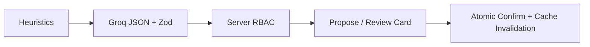
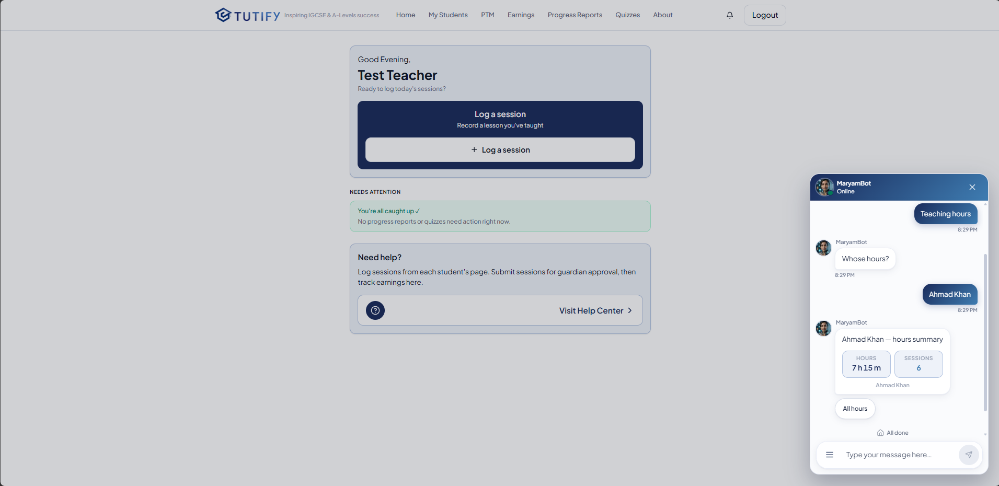

 

**Teacher-only AI assistant** for session logging and self-service reports — propose-then-confirm writes, server-enforced RBAC, shipped into [portal.tutify.org](https://portal.tutify.org/).

 

&nbsp;

 

> **Confidentiality:** Tutify Portal is a proprietary production application. This repository contains no source code—only a high-level engineering breakdown, synthetic-data UI screenshots, and architecture notes.

### The Problem & Workflow Shift

Logging lessons meant bouncing across student, enrollment, time-entry, and reporting screens. MaryamBot collapses that into a guided teacher-only chat inside the portal.

| Legacy portal flow | MaryamBot guided flow |
| --- | --- |
| Open student → pick enrollment cycle → enter PKT window or duration → save / submit → check hours and earnings on separate views | Chat or quick actions → resolve student → PKT date + time or duration → review card → draft or submit → in-chat reports |

### System Architecture

**RBAC & Financial Isolation** — `teacher_id` is resolved from the authenticated Supabase SSR session only. Every enrollment, session, and pay-term lookup is scoped to that teacher; internal client billing and margin fields are excluded. Persistence sits behind Postgres RLS and fail-closed flags (`ASSISTANT_MODE`, `ASSISTANT_ALLOWED_TEACHER_IDS`, `ASSISTANT_WRITES_ENABLED`).

**Hybrid Orchestration** — Quick-action chips, menus, and clarifications hit a deterministic heuristic parser first (zero tokens). Free-form prompts fall through to Groq with low-temperature, Zod-validated JSON — structured intent only, never SQL, raw IDs, or direct writes.

**Propose-Then-Confirm Guardrails** — Chat never writes sessions directly. Validated intents create a pending review card; confirmation atomically claims the action, re-checks ownership and PKT date bounds (`Asia/Karachi`, today or past 10 calendar days, no future dates), and releases the lock on failure so retries cannot duplicate records.

**Portal UX & Feature Flags** — Floating launcher and branded chat sheet across teacher routes (mobile bottom sheet / desktop popover), with student picker, bounded PKT calendar, and structured report cards. Confirmed writes invalidate TanStack Query caches so the Sessions view updates immediately. Flags fail closed; Vitest covers `MB-01`–`MB-10`.

### Interface Walkthrough *(Synthetic Seed Data)*

<table>
  <tr>
    <td width="50%" valign="top">
      <b>1. Teacher Portal Entry Point</b>
        
      
        
      Teacher portal home with the floating MaryamBot launcher in the bottom-right corner.
    </td>
    <td width="50%" valign="top">
      <b>2. Chat Open &amp; Quick Actions</b>
        
      
        
      Session logging prioritized up front, with Teaching hours, Earnings, and My students in the quick menu.
    </td>
  </tr>
  <tr>
    <td width="50%" valign="top">
      <b>3. Scoped Student Picker</b>
        
      
        
      Scoped roster picker resolving ambiguous names while preserving already-entered time slots.
    </td>
    <td width="50%" valign="top">
      <b>4. Propose-Then-Confirm Review Card</b>
        
      
        
      Verification card offering <i>Log &amp; submit</i> or <i>Save as draft</i> before atomic insertion.
    </td>
  </tr>
  <tr>
    <td colspan="2" valign="top">
      <b>5. Structured Teaching Hours Report</b>
        
      
        
      In-chat hours and session count breakdown rendered as structured summary cards.
    </td>
  </tr>
</table>

### Stack & Engineering Rigor

 

 

**Deep Dive**

- [Architecture Decisions](./docs/architecture-decisions.md) — why heuristics-first, propose-then-confirm, server RBAC, and fail-closed flags
- [Edge Cases & QA (`MB-01`–`MB-10`)](./docs/edge-cases-and-qa.md) — regression scenarios for ambiguity, PKT bounds, atomic retry, and build safety
