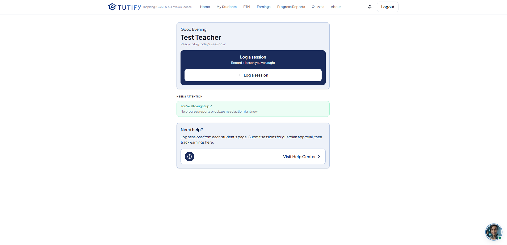
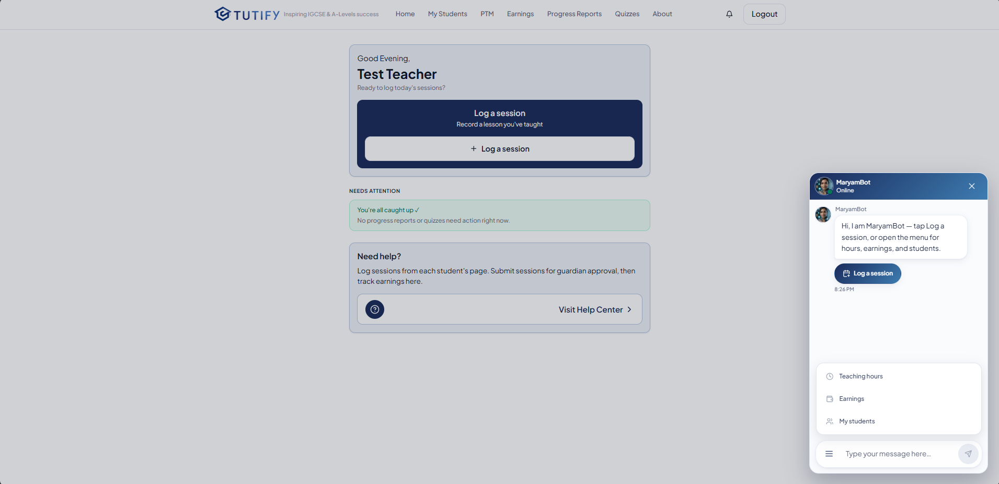
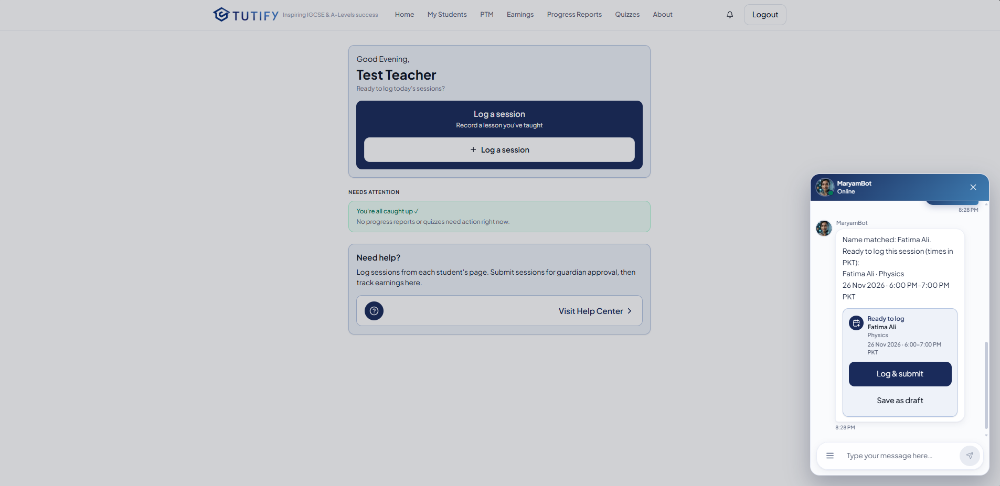

# MaryamBot — Teacher AI Assistant for Tutify

  

&nbsp;

## Overview

I built **MaryamBot**, a teacher-only conversational assistant embedded inside the Tutify tutoring management portal (`portal.tutify.org`). Designed around a propose-then-confirm write model and a hybrid deterministic-plus-LLM intent pipeline, it lets teachers log completed lessons and check routine account summaries without leaving their workflow or exposing internal financial data.

## The Problem

Logging completed sessions in Tutify normally requires navigating across multiple screens—opening a student, selecting an enrollment, entering duration or `Asia/Karachi` (`PKT`) start/end times, and saving as a draft or submitting for guardian approval—while teaching hours and earnings live on separate pages. Teachers needed a faster way to log sessions and look up hours, students, and estimated earnings while preserving strict teacher data scoping and write safety.

## What I Built

* **Guided Session Logging:** Step-by-step flow (`student → PKT date → start/end time or duration → review card → save draft or submit for approval`).
* **Read-Only Self-Service Queries:** Quick answers for teaching hours, cycle-wise estimated earnings for a named student, active/past/subject-filtered student rosters, and session counts.
* **Strict Scope Boundaries:** Built strictly for teachers—declines guardian, student, and admin actions, quizzes, PTMs, billing mutations, future-dated session logs, and off-topic chat.

## Architecture & Approach

### RBAC & Data Scoping
* Teacher identity is resolved server-side from the authenticated session—never trusted from client payloads or LLM outputs.
* All enrollment, session, and pay-term lookups are scoped to the authenticated teacher's enrollments, excluding sensitive client and admin billing fields and computing earnings from teacher pay terms and approved sessions only.
* Assistant storage is protected with Postgres Row-Level Security (RLS) with server service-role access only.

### Heuristic + LLM Orchestration
* **Layer 1 (Deterministic Heuristics):** Handles quick chips, menu actions, and multi-turn clarifications locally with zero LLM cost.
* **Layer 2 (Structured JSON LLM):** Uses Groq with a low-temperature, Zod-validated schema for free-form or ambiguous input—returning structured intent only, never querying the database, inventing student/enrollment IDs, or writing records.
* **Server Resolution & Resilience:** Resolves student names against scoped enrollments with disambiguation/fuzzy matching, supported by payload normalization, rate-limit retries, a bounded schema-repair retry, and a calm fallback when the LLM is unavailable.

### Propose → Confirm Guardrails
* Chat turns only propose actions by creating a pending review action and returning a review card.
* Confirmation atomically claims the pending action, re-validates ownership, eligibility, and `Asia/Karachi` (`PKT`) date bounds (today or the past 10 calendar days inclusive; no future dates), and creates a draft or submitted session.
* Failed inserts release the claim so retries do not falsely report success, concurrent confirms for a session are guarded, and mid-log topic diversions use a soft continue-or-start-over gate so drafts are not wiped accidentally.

### UI Integration
* Integrated as a floating launcher and branded chat sheet across teacher portal pages (home, sessions, students, earnings context) rather than a standalone app.
* Includes a hero **Log a session** chip, composer menu (**Teaching hours**, **Earnings**, **My students**), searchable student picker, bounded `PKT` calendar, structured report cards, and a review card with **Log & submit** and **Save as draft**.
* Invalidates teacher portal session queries after confirmation so chat and the portal session list stay in sync.

### Feature Flags & Staged Rollout
* Controlled by `ASSISTANT_MODE` (`off`, `allowlist`, `all`; default `off`, failing closed on unknown values), `ASSISTANT_ALLOWED_TEACHER_IDS`, and `ASSISTANT_WRITES_ENABLED` (default `false`).
* Keeps `GROQ_API_KEY` strictly server-side and supports builds without a Groq key for staged rollout (`off → allowlist → broader enable`).

## Tech Stack

* Next.js App Router, React, TypeScript, Tailwind CSS, Radix UI, TanStack Query
* Supabase Auth, PostgreSQL with RLS, server service client, additive SQL migrations with rollback
* Groq SDK, Zod
* `date-fns` / `date-fns-tz` (`Asia/Karachi` civil dates, UTC timestamp storage), Vitest, synthetic Teacher A/B local seed

## Edge Cases & Reliability

* Prevents silent wrong-student selection on ambiguous or surname-only matches while preserving date, time, and duration drafts across disambiguation.
* Distinguishes duration-only logging (*"I taught X for 90 minutes"*) from hour reports, retains partial start/end times while asking only for the missing bound, avoids silent AM/PM assumptions on bare time ranges, and rejects zero or negative durations.
* Handles subject aliases (`math`, `maths`, `mathematics`), treats qualifiers like *"past students"* as filters rather than student names, resolves unknown names before schedule collection, and catches future-date typos.
* Protects mid-flow state with a soft diversion gate, atomic confirm claims with release-on-failure, fail-closed flag defaults, clean handling of empty/oversized inputs or missing LLM config, and zero stack traces shown to teachers.

## Screenshots

*Note: All screenshots below use local synthetic demo data (`Test Teacher` and fixture student records).*

1. **Teacher portal with MaryamBot entry point**  
   

2. **Chat open — session logging first; hours, earnings, and students in the menu**  
   

3. **Guided session logging with a teacher-scoped student picker**  
   

4. **Review-before-write confirmation before creating a session**  
   

5. **In-chat hours report with structured summary cards**  
   

## Outcome / What This Demonstrates

* Product-minded AI feature design inside an existing multi-role portal.
* Server-side auth, RBAC, and financial data scoping discipline.
* Structured LLM usage with deterministic heuristics, Zod validation, and graceful fallbacks.
* Safe write paths with propose-then-confirm review cards, atomic claims/releases, and fail-closed feature flags.
* Thoughtful teacher UX, `PKT`/UTC date discipline, cache invalidation, and Vitest regression coverage.

*Private and company-specific implementation details are omitted where proprietary.*