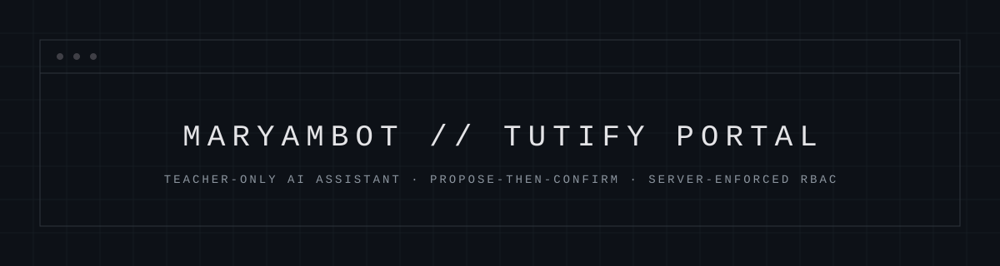
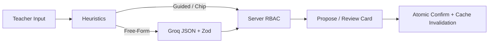
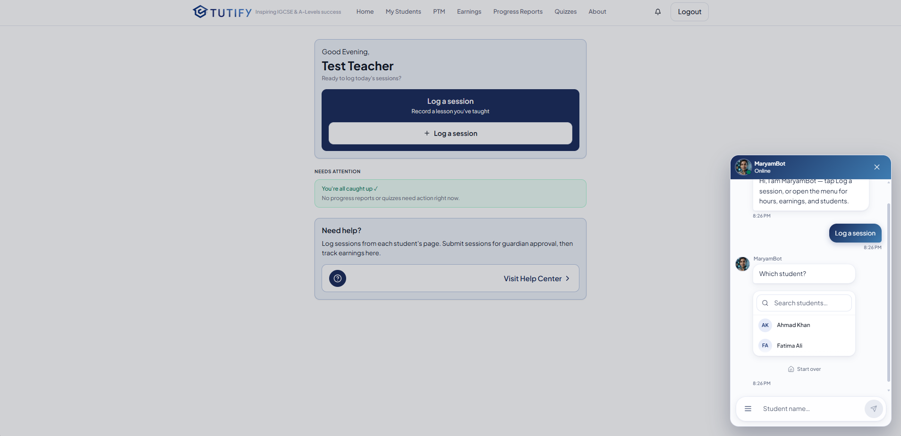

 

**Teacher-only AI assistant** — propose-then-confirm session logging with server-enforced RBAC, shipped into [portal.tutify.org](https://portal.tutify.org/).

 

&nbsp;

 

> **Confidentiality:** Tutify Portal is a proprietary production application. This repository contains no source code—only a high-level engineering breakdown, synthetic-data UI screenshots, and architecture notes.

### The Problem & Workflow Shift

| Workflow | Legacy Portal | MaryamBot |
| --- | --- | --- |
| **Session Logging** | Multi-screen student → cycle → time → save | Guided chat: student → PKT → review |
| **Ambiguous Names** | Manual search across roster screens | In-chat picker; time slots preserved |
| **Write Safety** | Immediate save with little confirm UX | Propose → review card → atomic confirm |
| **Hours & Earnings** | Separate reporting views | In-chat structured report cards |

### System Architecture

<table>
  <tr>
    <td width="50%" valign="top">
      <b>RBAC &amp; Financial Isolation</b>  
      Session-derived teacher identity only. 
      Scoped reads; billing margins never exposed.
    </td>
    <td width="50%" valign="top">
      <b>Hybrid Orchestration</b>  
      Heuristics first — zero tokens for chips. 
      Free-form → Groq JSON, Zod-validated intent.
    </td>
  </tr>
  <tr>
    <td width="50%" valign="top">
      <b>Propose-Then-Confirm</b>  
      Chat never writes sessions directly. 
      Atomic claim on confirm; safe retries.
    </td>
    <td width="50%" valign="top">
      <b>Portal UX &amp; Feature Flags</b>  
      Floating launcher + chat across teacher routes. 
      Fail-closed flags; Vitest <code>MB-01</code>–<code>MB-10</code>.
    </td>
  </tr>
</table>

### Interface Walkthrough *(Synthetic Seed Data)*

<table>
  <tr>
    <td width="50%" valign="top">
      <b>1. Teacher Portal Entry Point</b>
        
      
        
      Floating launcher on the teacher portal home.
    </td>
    <td width="50%" valign="top">
      <b>2. Chat Open &amp; Quick Actions</b>
        
      
        
      Chat open with session logging quick actions.
    </td>
  </tr>
  <tr>
    <td width="50%" valign="top">
      <b>3. Scoped Student Picker</b>
        
      
        
      Roster picker for ambiguous names, slots kept.
    </td>
    <td width="50%" valign="top">
      <b>4. Propose-Then-Confirm Review Card</b>
        
      
        
      Review card before draft or submit confirm.
    </td>
  </tr>
  <tr>
    <td colspan="2" valign="top">
      <b>5. Structured Teaching Hours Report</b>
        
      
        
      In-chat hours and session count summary cards.
    </td>
  </tr>
</table>

### Stack & Engineering Rigor

 

 

**Deep Dive**

- [Architecture Decisions](./docs/architecture-decisions.md) — why heuristics-first, propose-then-confirm, server RBAC, and fail-closed flags
- [Edge Cases & QA (`MB-01`–`MB-10`)](./docs/edge-cases-and-qa.md) — regression scenarios for ambiguity, PKT bounds, atomic retry, and build safety
